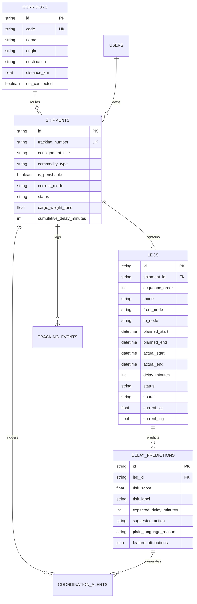

# Database Layer & Schema Documentation
**SIH 2026 - Problem Statement: Unified Multimodal Freight Visibility Platform**
**Team: Jugaad Junction**

## 1. Overview

The relational PostgreSQL schema models the complete multimodal handoff lifecycle, tracking consignments across Road (FASTag), Rail (FOIS CRIS), ICD Dry Ports (ICEGATE/CONCOR), and Sea Ports (PCS1x IPA).

---

## 2. Entity-Relationship Model



---

## 3. Running Migrations & Seeding

### Direct SQL:
```bash
# Apply schema
psql -U postgres -d freight_visibility -f schema.sql

# Seed initial corridors and shipments
psql -U postgres -d freight_visibility -f seed.sql
```

### Prisma ORM (TypeScript):
```bash
# Push schema to database
npx prisma db push

# Seed data
npx prisma db seed
```
